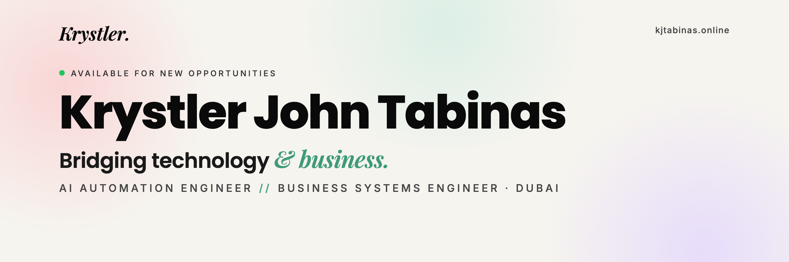

  

  
  
  

 

## Bridging technology & business

**I build the systems a business actually runs on, and then automate the work around them.**

AI Automation Engineer specializing in designing and deploying production-ready workflow automations, AI agents and API integrations. I build internal business systems, automate operational workflows and ship quickly with AI-assisted development tools like Claude Code, ChatGPT and Gemini, owning projects end to end with minimal supervision.

Currently based in Dubai, building AI agents, workflow automations and internal business systems at **Luxe Signature Holiday Homes**, and shipping my own products on the side.

| 3+ | 6 | 412 | 5 |
| :---: | :---: | :---: | :---: |
| years building systems | systems built end to end | units managed on the PM platform | companies across two countries |

## What I can help you with

- **AI agents & automation:** agents and workflows that take real work off a team: drafting, reconciling, chasing, reporting. Built with Claude Code and MCP, wired into the tools you already use.
- **Internal business systems:** property management, HR, approvals, invoicing and reporting, designed around how the office actually operates and shipped to production.
- **Apps & integrations:** web and mobile apps with the integrations behind them: REST APIs, webhooks, payment and document flows, offline-first where it matters.
- **Low-code & data:** fast internal tooling and dashboards on the Microsoft stack, and the spreadsheets and reports that finance still runs on.

## Tools I reach for

  
  
  
  
  

  
  
  
  
  
  
  

  
  
  
  
  
  

  
  
  
  

## Things I have built

| # | System | What it is | Stack | Status |
| :---: | :--- | :--- | :--- | :---: |
| 01 | **[Auréne](https://aurene.live)** | Clinic operating system for dermatology and aesthetic practices: patient CRM, scheduling, clinical records, packages and VAT-correct billing in one multi-tenant workspace. | Next.js · React · Cloudflare | 🟢 Live |
| 02 | **[Nexoro](https://nexoro.digital)** | Quote-to-invoice ERP for trading companies: quotations, approvals, sales orders, delivery notes, tax invoices and stock on one set of customers, products and prices. | React · Cloudflare | 🟢 Live |
| 03 | **[Fleeto](https://fleeto.digital)** | Car rental management SaaS, from a single lot to a multi-branch fleet: documents and expiry alerts, double-booking-proof reservations, handovers with mileage, fuel and photos. | Next.js · React · Vercel | 🟢 Live |
| 04 | **Property Management System** | All-in-one platform for UAE holiday homes and rentals, 412 units across 68 properties: leases, tenants, landlords, agents, rent collection, invoicing, approvals and maintenance. | Supabase · Cloudflare | 🟢 Live |
| 05 | **Long-Term Lease System** | Annual tenancy, cheque and renewal management for Dubai: creating a tenancy generates the contract terms, a post-dated cheque schedule and the tenancy record at once. | Supabase · Cloudflare | 🟢 Live |
| 06 | **HRIS** | Full HR system built from scratch: employee records, biometric attendance sync, leave and cash-advance requests, approvals, payroll and recruitment, with self-service for every employee. | Supabase · Workflow automation | 🟢 Live |

> These repositories are private. Screens, write-ups and case studies are on **[kjtabinas.online](https://kjtabinas.online)**.

**Open source:** [Reclip](https://github.com/lestify12/reclip) turns long streams into captioned, ready-to-post Shorts on your own computer, with AI titles, scheduling and an Auto-pilot that clips hyped streams.

## Where I have worked

| When | Company | Role |
| :--- | :--- | :--- |
| Dec 2025 – Present | **Luxe Signature Holiday Homes**, Dubai | AI Automation Engineer · Business Systems Engineer |
| Apr 2025 – Dec 2025 | **Suliter International Building Materials Trading L.L.C**, Dubai | Business Systems & IT Administrator |
| Feb 2024 – Feb 2025 | **GC&C Group · Cleverminds Digital Solutions Inc.**, Philippines | IT Administrator · Flutter Developer |
| Jul 2023 – Dec 2023 | **Lexmark International Philippines** | DX Solutions Developer (Power Platform) |
| Feb 2023 – Apr 2025 | **YLifestyle Design & Management**, remote | IT Operations & Automation Specialist |

**Education:** BS Computer Engineering, Cebu Institute of Technology – University, class of 2023.

## Now

AI Automation Engineer at Luxe Signature Holiday Homes in Dubai, running the property platform, the HRIS and the automations that connect them. Open to automation, internal tooling and mobile work, in the UAE or remote: tell me what is slowing your team down and I will tell you what I would build.

## Let's work together

  
  
  
  

  Languages: English · Filipino

